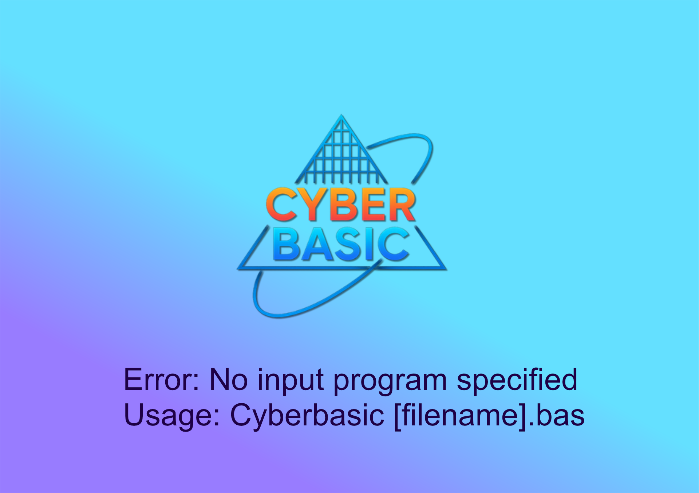

<p align="center"></p>

# CyberBasic

A modern BASIC for making 2D and 3D games, in the spirit of Blitz3D and AGK2. You write in a simple BASIC, or later build games visually with nodes. Everything runs on a modern renderer (Babylon.js), and finished games export without the editor.

> **Status: early development.** This is a full rewrite; the old C++/raylib interpreter is in this repo's git history. Phase 0 is done and the core language works. Progress and roadmap are in [PLAN.md](PLAN.md).

```basic
Game "Pong-ish"
Graphics 800, 600

Global score

Function Paddle(y)
    If KeyDown(KEY_UP) Then y -= 400 * Delta
    If KeyDown(KEY_DOWN) Then y += 400 * Delta
    Return Max(0, Min(510, y))
End Function

While Not KeyHit(KEY_ESCAPE)
    y = Paddle(y)
    Cls
    Rect 30, y, 14, 90
    Text 10, 10, "Score: " + score
    Sync
Wend
```

## Quick start

Requires [Rust](https://rustup.rs) and a browser.

```sh
cargo run --release -- run examples/pong.cb
```

This compiles `examples/pong.cb` into `examples/build/pong/` and opens it. Use `build` instead of `run` to only write the files. The output folder is a standalone web game (`index.html`, `runtime.js`, `game.js`, plus an `assets/` folder if one sits next to your `.cb` file).

> Games load Babylon.js from its CDN, so for now they need an internet connection.

### Playground

Edit and run CyberBasic in the browser; the compiler runs there as WebAssembly.

```sh
rustup target add wasm32-unknown-unknown
cargo build --release -p cyberbasic --lib --target wasm32-unknown-unknown
python -m http.server 8765
```

Then open <http://localhost:8765/playground/>. **Ctrl+Enter** runs the code.

## Examples

| File | Shows |
|------|-------|
| [examples/cube.cb](examples/cube.cb) | 3D camera, light, meshes, HUD text |
| [examples/pong.cb](examples/pong.cb) | Two-player 2D game: functions, globals, constants, collision |
| [examples/breakout.cb](examples/breakout.cb) | `Type`s, `For … Each`, `Delete`, arrays, mouse control |
| [examples/drift.cb](examples/drift.cb) | Animated sprite sheet, rotation, screen wrap |
| [examples/marble.cb](examples/marble.cb) | Havok physics, a glTF model, raycast ground check, follow camera |

## How it works

```
file.cb ──▶ Rust compiler ──▶ game.js ──▶ CyberBasic runtime ──▶ Babylon.js / Canvas 2D
           (lex, parse, codegen)  (JS generators)   (runtime/runtime.js)
```

The program and every function compile to JavaScript generators. `Sync`, `Delay` and loading commands `yield`, and the runtime resumes the program once per frame, so classic `While … Sync … Wend` game loops run in the browser without freezing it. A loop that never reaches `Sync` is stopped after 5 seconds with an error.

## Language

```basic
' comment
x = 10 : y = 20              ' `:` puts several statements on one line
name$ = "Ada"                ' Blitz suffixes (# % $) are accepted
Const SPEED = 300, SIZE = 32
Global lives = 3, score      ' visible inside functions

If x > 5 Then Print "big" : x = 0 Else Print "small"   ' everything after Then belongs to the If
If x = 1
    ...
ElseIf x = 2
    ...
Else
    ...
EndIf                        ' or End If

For i = 1 To 10 Step 2 : Print i : Next
While x < 100 : x += 1 : Wend
Repeat : x -= 1 : Until x = 0
Repeat ... Forever           ' leave any loop with Exit

Select key
Case 1, 2
    ...
Default
    ...
End Select

Function Add(a, b)           ' can be called before it is defined
    Return a + b             ' variables inside are local unless Global
End Function

Dim grid[10, 10]             ' 0-based, bounds-checked
grid[2, 3] = 1

Type Enemy
    Field x, y, hp
End Type
e = New Enemy : e.hp = 3
For e = Each Enemy
    If e.hp <= 0 Then Delete e
Next
```

- Operators: `+ - * / Mod ^`, `= <> < <= > >=`, `And Or Not`, `+=`, `-=`. `+` joins strings.
- Commands and keywords are case-insensitive. `Delta` is the seconds since the last frame.
- `End` stops the program from anywhere.

## Commands

| Area | Commands |
|------|----------|
| Setup | `Game title`, `Graphics w, h`, `Graphics3D w, h` |
| 2D drawing | `Cls`, `ClsColor r,g,b`, `Color r,g,b`, `Rect x,y,w,h[,fill]`, `Oval x,y,w,h[,fill]`, `Line x1,y1,x2,y2`, `Plot x,y`, `Text x,y,value`, `GraphicsWidth()`, `GraphicsHeight()` |
| Images | `LoadImage(path)`, `LoadAnimImage(path, frameW, frameH, first, count)`, `DrawImage img,x,y[,frame]`, `DrawImageEx img,x,y,angle,scale[,frame]` (centered), `ImageWidth(img)`, `ImageHeight(img)`. Frame numbers wrap around. |
| Sound | `LoadSound(path)`, `PlaySound snd` |
| Input | `KeyDown(key)`, `KeyHit(key)`, `MouseX()`, `MouseY()`, `MouseDown([button])`, `MouseHit([button])` (1 left, 2 right, 3 middle), `JoyX()`, `JoyY()`, `JoyDown(button)` |
| Time / output | `Delay ms`, `Millisecs()`, `Print value` (browser console) |
| Math | `Abs`, `Sqr`, `Sin`, `Cos`, `Tan`, `ATan2` (degrees), `Floor`, `Ceil`, `Int`, `Float`, `Min`, `Max`, `Rnd([min,] max)`, `Rand([min,] max)`, `RectsOverlap(x1,y1,w1,h1, x2,y2,w2,h2)` |
| Strings | `Str`, `Len`, `Left`, `Right`, `Mid(s, start[, n])`, `Upper`, `Lower`, `Chr`, `Asc`, `Instr`, `Replace`, `Trim` (positions start at 1) |
| 3D | `CreateCamera()`, `CreateLight([LIGHT_DIRECTIONAL \| LIGHT_POINT])`, `CreateCube([size])`, `CreateSphere([size])`, `CreatePlane([size])`, `PositionEntity`, `MoveEntity`, `RotateEntity`, `TurnEntity`, `PointEntity`, `ScaleEntity` (all `e, x, y, z`), `EntityColor e,r,g,b`, `FreeEntity e`, `EntityX/Y/Z(e)`, `EntityDistance(a, b)`, `AmbientLight r,g,b`, `LoadMesh(path)` (.glb/.gltf), `LinePick(x,y,z, dx,dy,dz)` (mesh hit or 0), `EntityPickMode e, 0\|1` |
| Physics | `EnablePhysics [gx, gy, gz]`, `EntityPhysics e, mass[, bounce]` (mass 0 = static; spheres get a sphere shape, others a box), `ApplyImpulse e,x,y,z`, `SetVelocity e,x,y,z`, `EntityCollided(a[, b])` (started touching in the last step) |

`LoadImage`, `LoadAnimImage`, `LoadSound`, `LoadMesh`, `EnablePhysics` and `Delay` wait without freezing the game: frames keep rendering until they finish. Havok physics and the glTF loader are downloaded only when a game first uses them.

Keys: `KEY_A`–`KEY_Z`, `KEY_0`–`KEY_9`, `KEY_ESCAPE`, `KEY_SPACE`, `KEY_ENTER`, `KEY_LEFT`, `KEY_RIGHT`, `KEY_UP`, `KEY_DOWN`.

## Project layout

```
crates/cyberbasic/   compiler + CLI (Rust, no dependencies); also builds to WASM
runtime/             runtime.js and the index.html page template
playground/          in-browser editor using the WASM compiler
examples/            sample games
PLAN.md              product plan, roadmap and progress
```

## Development

```sh
cargo test
```

Tests cover parsing, code generation and error messages. If Node.js is installed, they also compile small programs, run them against the real runtime and check the output. A parity test makes sure every compiler command exists in the runtime.

## License

See [LICENSE](LICENSE).
